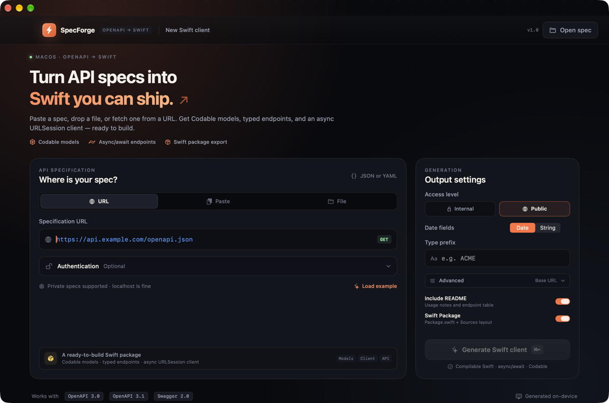
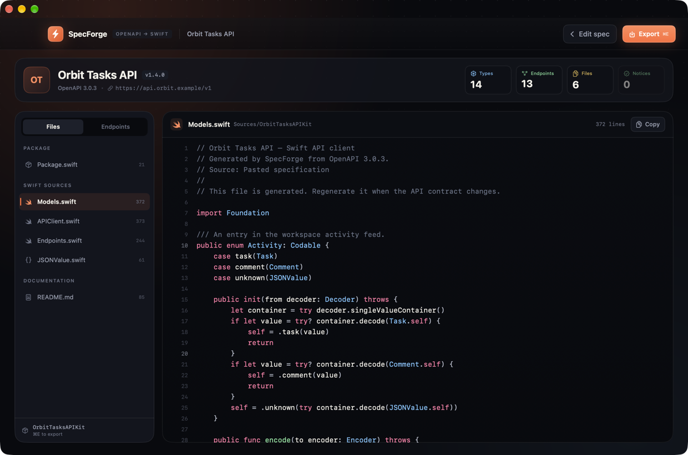

# SpecForge

**Turn OpenAPI specs into Swift you can ship.**

SpecForge is a native macOS app that converts OpenAPI 3.x and Swagger 2.0 documents into a ready-to-build Swift package: Codable models, typed endpoints, and an async/await `URLSession` client.

[Website](https://lbkos.github.io/specforge) · [Download for macOS](https://github.com/LBkos/specforge/releases/latest/download/SpecForge.dmg) · [GitHub](https://github.com/LBkos/specforge)



## Highlights

- **Three ways in** — fetch a spec from a URL, paste JSON/YAML, or drop a spec file.
- **Auth-aware fetching** — Bearer token, API key (header or query), or HTTP Basic auth for private spec URLs. Credentials are used only for the fetch and are never written into generated code.
- **OpenAPI 3.0, 3.1, and Swagger 2.0** — JSON and YAML supported.
- **Real Swift output** — `Codable` structs and classes, string/integer enums, oneOf/anyOf unions, allOf flattening, recursive models, dictionaries, and a `JSONValue` fallback.
- **Typed networking** — one async method per operation, path/query/header parameters, JSON request bodies, text and binary responses, ISO 8601 date handling, and typed `APIError`s.
- **A complete package** — exports `Package.swift`, sources, and a README with endpoints and usage. It builds with SwiftPM out of the box.
- **Native and private** — SwiftUI macOS app. Specs are processed on-device; no analytics or telemetry.



## Requirements

- macOS 14 or later
- Xcode 16+ to build from source (the checked-in project was built with Xcode 27 / Swift 6)
- [XcodeGen](https://github.com/yonaskolb/XcodeGen) only if you want to regenerate the project from `project.yml`

The app depends on [Yams](https://github.com/jpsim/Yams) for YAML parsing. Xcode resolves it automatically.

## Run from source

```bash
open SpecForge.xcodeproj
```

Choose the **SpecForge** scheme and press **Run**.

Or build a signed, universal `.app`, `.zip`, and `.dmg` from the command line:

```bash
./scripts/build-app.sh
```

Artifacts are written to `dist/`.

> The command-line build uses ad-hoc signing. The app is not notarized, so on another Mac, right-click **SpecForge.app → Open** the first time if Gatekeeper prompts.

## Use

1. Choose **URL**, **Paste**, or **File**.
2. For a private URL, open **Authentication** and enter the credentials needed to download the spec.
3. Adjust access level, date mapping, type prefix, or the base URL override.
4. Press **Generate Swift client** (`⌘↩`).
5. Review each generated file, then press **Export** (`⌘E`) and choose where to create the package folder.

Try it immediately with **Load example** — it uses a bundled Orbit Tasks API specification that exercises enums, unions, recursive models, pagination, binary downloads, and text responses.

## What gets generated

```text
OrbitTasksAPIKit/
├── Package.swift
├── README.md
└── Sources/
    └── OrbitTasksAPIKit/
        ├── Models.swift
        ├── APIClient.swift
        ├── Endpoints.swift
        └── JSONValue.swift   # only when a flexible JSON fallback is needed
```

The networking client supports authentication at runtime:

```swift
let client = APIClient(auth: .bearer("YOUR_TOKEN"))
let tasks = try await client.listTasks(workspaceID: "ws_123")
```

Other auth options:

```swift
APIClient(auth: .apiKey("YOUR_KEY", name: "X-API-Key", location: .header))
APIClient(auth: .basic(username: "user", password: "secret"))
```

## Supported behavior and limits

Supported:

- OpenAPI 3.0/3.1 and Swagger 2.0, JSON or YAML
- `$ref` schemas, parameters, request bodies, and responses
- Nested objects, arrays, maps, string/integer enums, `allOf`, `oneOf`/`anyOf`, nullable fields, and recursive models
- Path, query, and header parameters; JSON bodies; JSON, text, binary, and empty responses
- URL fetching with Bearer/API key/Basic auth

Intentionally not supported yet:

- External `$ref` documents (they produce a notice and a `JSONValue` fallback)
- Multipart and form-urlencoded request bodies (skipped with a notice)
- Cookie parameters
- Typed error response bodies (HTTP errors are surfaced through `APIError.httpStatus(code:data:)`)
- Full JSON:API-style polymorphism and discriminator-driven decoding; unions try each variant in order

These limits are surfaced in the **Notices** panel after generation rather than silently producing incomplete code.

## Project structure

- `SpecForge/App` — app entry point and menu commands
- `SpecForge/Views` — SwiftUI input, results, code viewer, auth editor
- `SpecForge/ViewModels/AppModel.swift` — app state and generation flow
- `SpecForge/Services` — spec parsing, fetching, Swift generation, export, syntax highlighting
- `SpecForgeTests` — generator, export, SwiftPM build, and auth-fetch integration tests
- `docs/` — the static SpecForge landing page deployed with GitHub Pages
- `scripts/build-app.sh` — universal release build + signing + DMG/ZIP packaging

## Tests

```bash
./scripts/test.sh
```

The suite verifies:

- OpenAPI 3 and Swagger 2 YAML generation
- Generated Swift compiles with `swiftc`
- The exported Swift package builds with `swift build`
- Exported files and package layout
- Type prefixes and flat output mode
- Bearer, API key (header/query), and Basic auth fetching against a local HTTP server
- Unauthorized responses and unsupported spec errors

## Privacy

Generated clients, specs, and credentials stay on your Mac. Authentication is only attached to the outgoing spec request. No token is embedded in the generated sources.

---

Made with SwiftUI. Not affiliated with Apple or OpenAPI Initiative.
